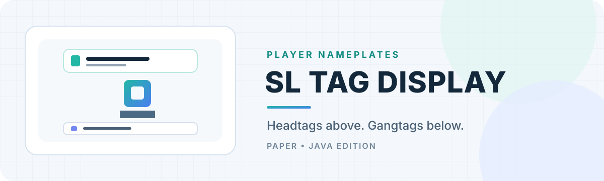

# SL Tag Display

SL Tag Display is a Minecraft Java plugin for Paper servers. Players choose a headtag and a gangtag from tags they are allowed to use, and the plugin displays each in its own place around their name.

The project is in early development. The current build includes tag displays, selection menus and saved choices, permission and Discord role access, Discord account linking, and a PlaceholderAPI headtag placeholder. We’ll keep this page up to date as the plugin grows.

## What the plugin will do

### Headtags

- Show the player's selected headtag above their name in the world.
- Provide an appended PlaceholderAPI placeholder for server owners to use in chat formats.
- Leave the server's existing chat format and tab list alone. In particular, the plugin will not replace or reorder LuckPerms prefixes or TAB formatting. The headtag appears in chat only when a server owner adds its placeholder to their chat format.

### Gangtags

- Show the player's selected gangtag below their name in the world.
- Keep the gangtag out of chat and tab list formatting by default.
- Any later gangtag placeholder will be opt-in: it will have no effect unless a server owner explicitly adds it to a format.

### Player choices and permissions

- Players choose their own active headtag and gangtag from in-game menus.
- Access can use permission nodes, DiscordSRV-linked Discord roles, or the plugin's optional built-in Discord bot and account-link flow. Choose one with `access.mode` in `config.yml`.
- A tag's permission node always grants access, including in either Discord mode. A Discord role can also grant access to a player who does not have that permission node.
- Discord access can be switched off completely by setting `access.mode: permissions`. Permission nodes then become the sole access method. `fallback-to-permissions: true` can additionally grant access from a tag's permission node when the selected Discord provider is unavailable or still loading.
- Each tag can list multiple Discord role IDs, and one Discord role can be listed on multiple tags. When permission fallback is enabled, configure a permission node on every Discord-gated tag too.
- LuckPerms can manage the permission nodes, along with any other compatible permissions plugin.
- Players cannot create or edit tag definitions.
- A player's headtag and gangtag choices are saved separately.

### Administration and reliability

- Administrators can create, edit, and remove tag definitions in configuration or with in-game admin commands.
- Administrators can reload tag configuration without restarting the server.
- The headtag and gangtag systems are separate modules. An issue in one should not disable the other.

## Compatibility targets

The project will produce two builds from one codebase:

| Build | Server target | Java |
| --- | --- | --- |
| Main | Paper 26.3 and later 26.x releases | 25 |
| Compatibility | Paper 1.21.11 | 21 |

The 1.21.11 build is for testing the plugin on that server version. The builds use matching Paper API dependencies and `api-version` metadata. Shared code will be kept compatible with the 1.21.11 API; version-specific behavior can be isolated in adapters.

## Optional integrations

- **DiscordSRV:** can supply linked account and Discord role information without requiring this plugin to run its own bot.
- **Built-in Discord bot:** optional alternative to DiscordSRV. Players run `/tagdisplay link`, then use the one-time code with the bot's `/sltagdisplay link` Discord command. Set the bot token in the environment variable named by `access.discord.token-environment-variable`; the default is `SLTAGDISPLAY_DISCORD_TOKEN`. The bot needs the Server Members privileged intent enabled in the Discord Developer Portal.
- **LuckPerms:** can manage permission nodes used directly or as a fallback. The plugin uses normal server permission checks.
- **PlaceholderAPI:** provides `%sltagdisplay_headtag%` for chat-format plugins. PlaceholderAPI is optional; in-world displays work without it.
- **TAB:** the plugin will not modify TAB's player list formatting.
- **GitHub Releases:** on startup, the plugin checks the configured repository for a newer release. Operators receive a clickable release notice in chat when an update is available. Set `update-check.enabled: false` to turn this off.

To use only permission nodes, set `access.mode: permissions`; no Discord connection is started. Permission nodes always grant access regardless of role membership. Set `access.fallback-to-permissions: true` if you also want permission nodes to grant access to players who lack a Discord role while Discord is unavailable or still loading.

## Build

The project uses Gradle and Paper's standard Bukkit-compatible `plugin.yml` format.

```text
gradle build -PpaperTarget=26.3
gradle build -PpaperTarget=1.21.11
```

The output JAR filename identifies its target. The Paper version can be changed with `paperTarget`; use a supported 26.x release for the main build, or `1.21.11` for the compatibility build.

## Current implementation status

- Project scaffold and both Paper build targets: implemented and built.
- Tag configuration, menus, saved choices, display entities, and permission/Discord role checks: implemented.
- DiscordSRV role lookup and optional built-in Discord bot/link flow: implemented; needs configuration and live-server verification.
- PlaceholderAPI headtag expansion: implemented and optional.
- GitHub release update check and startup banner: implemented.
- In-game creation/editing of tag definitions: not yet implemented; configure tags in `config.yml`.

See [`docs/requirements.md`](docs/requirements.md) for the fuller requirements and design notes.
